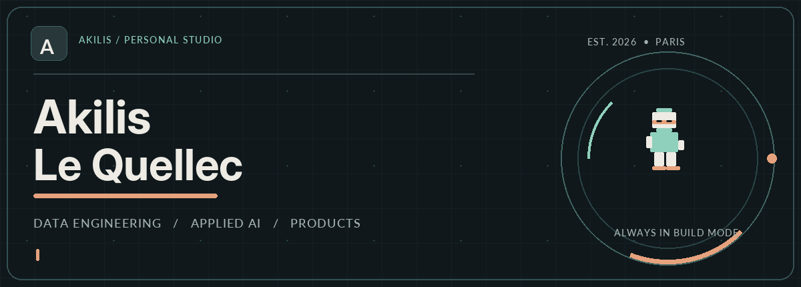
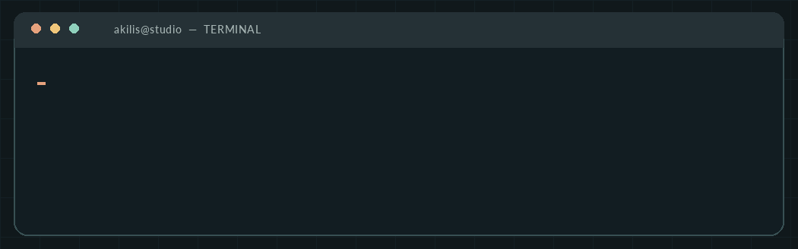
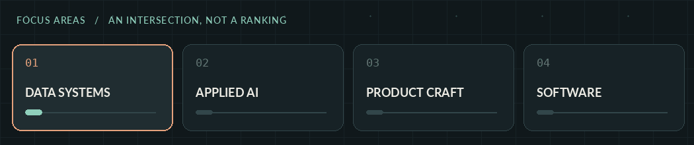
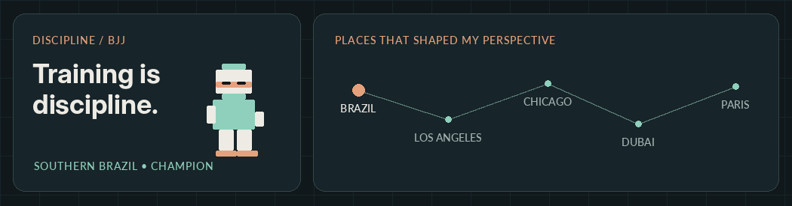

 

### Data engineer by discipline. Product builder by curiosity.

I bring **business perspective**, **data engineering** and **hands-on software development** together to build useful products.

---

## A little about me

I'm **Akilis Le Quellec**, a data engineer interested in the point where **technology, business and good product decisions** meet. My background includes **ICN Business School**, and I'm beginning my journey at **42 in November 2026** to deepen my foundations in software engineering.

I enjoy taking an idea from the first question to a working prototype: defining the problem, building alongside a team, testing assumptions and explaining the result clearly.

  

## What I focus on

  

| Engineering mindset | Product mindset |
| :-- | :-- |
| Data workflows, thoughtful architectures, reliability and iteration. | Real user problems, clear experiences, fast prototypes and measurable value. |

> **My principle:** useful beats flashy. The best interface is the one that helps someone make a better decision.

## Selected work

<table>
  <tr>
    <td width="50%" valign="top">
      <h3>🛡️ SOLEN</h3>
      
<strong>AI-assisted email fraud detection</strong>

      
Co-developed, tested and presented with a four-person team at the <strong>FINAXYS × Mistral AI</strong> hackathon in October 2026. SOLEN pairs deterministic email-security checks with contextual AI to surface suspicious payment requests and explain the risk.

      
<a href="https://github.com/akls-lq/Solen"><strong>Repository</strong></a> · <a href="https://solen-demo.vercel.app/"><strong>Live demo</strong></a>

      
Hackathon proof of concept · Outlook-style demo, not a production extension

    </td>
    <td width="50%" valign="top">
      <h3>◈ NEXTWISE / AI AGENT</h3>
      
<strong>Exploring agentic product experiences</strong>

      
A private, ongoing project exploring how AI agents can support real workflows. I'm using it as a space to experiment with architecture, automation and the gap between an impressive demo and a genuinely useful product.

      
<strong>Private development · Case study coming later</strong>

      
No private code or confidential details shared here

    </td>
  </tr>
</table>

## Learning, building, evolving

**ICN Business School** shaped my interest in business and strategy. **42** is the next step in strengthening my software engineering fundamentals. Between the two, I want to work on products that are both technically sound and worth building.

**Currently working with or exploring:**

*These represent project exposure and areas of interest—not claims of expert mastery in every technology.*

## Outside the editor

  

**Brazilian Jiu-Jitsu** is a serious part of my life. As a **Southern Brazil champion**, it taught me to stay calm under pressure, prepare consistently and improve through repetition. Those habits translate directly to engineering.

Travel has also shaped how I think. From **Brazil** to **Los Angeles**, **Chicago**, **Dubai** and **Paris**, I've learned to stay curious about how people live, work and solve problems differently.

## GitHub, in motion

Live contribution data — generated automatically after enabling the repository workflow.

<picture>
  <source media="(prefers-color-scheme: dark)" srcset="https://raw.githubusercontent.com/akls-lq/akls-lq/output/snake-dark.svg" />
  <source media="(prefers-color-scheme: light)" srcset="https://raw.githubusercontent.com/akls-lq/akls-lq/output/snake.svg" />
  
</picture>

View public GitHub stats

 

 Stats card relies on a third-party service and may occasionally be unavailable.

---

### Thoughtful engineering. Real-world impact.

*Build with curiosity. Improve with discipline. Keep the human in the loop.*

[GitHub](https://github.com/akls-lq) · [LinkedIn](https://www.linkedin.com/in/akilis-le-quellec/) · [SOLEN](https://github.com/akls-lq/Solen)

Designed for the <a href="https://github.com/akls-lq">akls-lq</a> GitHub profile · Original visuals and animations

