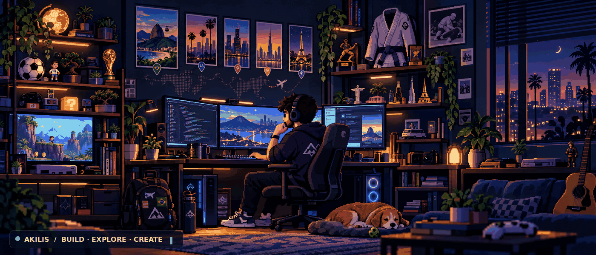
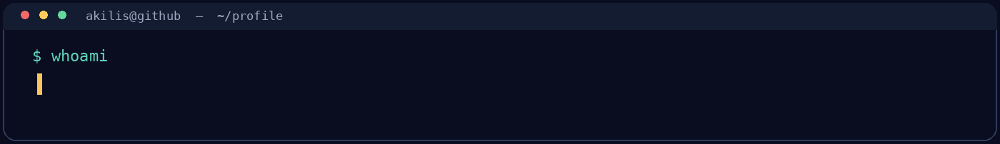
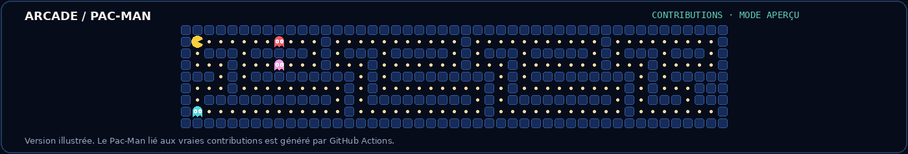

<h1>Akilis Le Quellec</h1>

<h3>Étudiant à ICN Business School &amp; 42 Paris</h3>

  Data Engineering · Développement logiciel · Intelligence artificielle

  Je transforme des idées en projets concrets.

<!-- RÉSEAUX SOCIAUX : VRAIS LOGOS, SANS CADRE -->

  
  &nbsp;&nbsp;&nbsp;&nbsp;
  
  &nbsp;&nbsp;&nbsp;&nbsp;
  

---

<h2 align="center">À propos de moi</h2>

  Passionné par la <b>programmation</b>, la <b>data</b> et l'<b>IA appliquée</b>.
   
  J'aime construire des produits utiles, relever des défis techniques
  et participer à des hackathons.

  

---

<h2 align="center">Langages & outils</h2>

<!-- VRAIS LOGOS, SANS TABLEAU NI BORDURE -->

  
  &nbsp;&nbsp;&nbsp;&nbsp;
  
  &nbsp;&nbsp;&nbsp;&nbsp;
  
  &nbsp;&nbsp;&nbsp;&nbsp;
  

  <b>Python</b> &nbsp;·&nbsp; <b>C</b> &nbsp;·&nbsp; <b>Shell / Bash</b> &nbsp;·&nbsp; <b>Git</b>

---

<h2 align="center">Projet à découvrir</h2>

<h3 align="center">SOLEN</h3>

  <b>Détection de fraudes par e-mail assistée par intelligence artificielle.</b>

  Prototype développé en équipe lors du hackathon
  <b>FINAXYS × Mistral AI</b> en octobre 2026.

  <a href="https://github.com/akls-lq/Solen"><b>Code GitHub</b></a>
  &nbsp;&nbsp; | &nbsp;&nbsp;
  <a href="https://solen-demo.vercel.app/"><b>Voir la démonstration</b></a>

---

<h2 align="center">Mes statistiques GitHub</h2>

  Statistiques publiques actualisées automatiquement selon les données disponibles sur GitHub.

---

<h2 align="center">Pac-Man & activité GitHub</h2>

  Animation Pac-Man personnalisée avec labyrinthe et fantômes.

  
<b>Voir le Pac-Man de mes contributions GitHub</b>

  

    
  

  

    Disponible après activation et exécution du workflow Pac-Man dans GitHub Actions.
  

---

<h2 align="center">En dehors du code</h2>

  🥋 <b>Jiu-jitsu brésilien</b> — Champion du Sud du Brésil
    
  🌍 <b>Voyages</b> — Brésil · Los Angeles · Chicago · Dubaï · Paris
    
  🎮 <b>Gaming</b> — GTA · FIFA · Mario

---

<h3>Créer. Apprendre. Construire.</h3>

  <a href="https://www.linkedin.com/in/akilis-le-quellec/">LinkedIn</a>
  &nbsp;·&nbsp;
  <a href="mailto:akilis.leq@gmail.com">E-mail</a>
  &nbsp;·&nbsp;
  <a href="https://github.com/akls-lq/Solen">SOLEN</a>

Akilis Le Quellec © 2026

